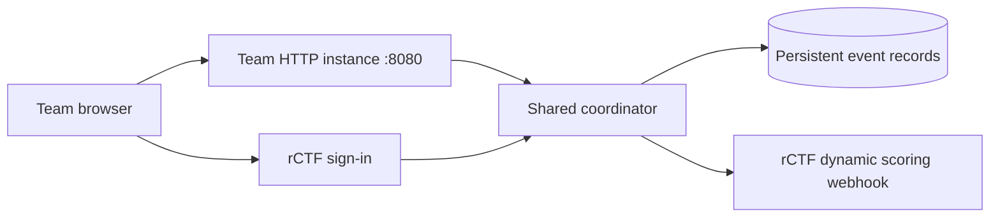

# APEX GP on rCTF

This deployment gives each rCTF team an HTTP game instance, unlimited practice, three server-counted qualifying rounds, a retained best lap, and automatically updated rCTF points. The public instance uses HTTPS; its container listens on HTTP port **8080**. There is no flag to submit.

## Compatibility

The integration targets **otter-sec/rctf with the documented V2 external-app, instancer, and dynamic-score APIs**, checked on 2026-10-22. An older redpwn/rCTF deployment may not have these features. Confirm your event's fork/version before deploying. Ordinary solve-count decay cannot assign different points to different teams; it cannot implement this format by itself.

Required platform capabilities:

- An external app registered in rCTF's admin settings.
- `GET /api/v2/users/me` and `GET /api/v2/integrations/challs/:id/instance`.
- A `dynamic` challenge with a signed `POST /api/v2/challs/:id/scores` feed.
- A Docker or Kubernetes instancer that supplies the resolved public endpoints to the gateway.

References: [rCTF scoring](https://rctf.osec.io/admin/scoring/), [external apps](https://rctf.osec.io/admin/external-auth/), [Docker instancer](https://rctf.osec.io/integrations/instancer/docker/), [instance status](https://rctf.osec.io/api/integrations/instance-status/), [challenge admin API](https://rctf.osec.io/api/admin/challenge-update/).

## Architecture and scoring



The instance is a stateless gateway. All ranked physics replay, attempts, best laps and score publication run in **one shared coordinator process** with a persistent volume. Restarting or recreating an instance cannot create a fourth attempt. This also means adding gateway instances does not increase the coordinator's simulation capacity. Do not run multiple coordinator processes against the same files.

Sign-in identifies the rCTF team UUID and checks that rCTF lists the opened HTTP endpoint as that team's running instance. The game then uses an HttpOnly cookie scoped to the instance. Full rCTF account tokens are discarded after the ownership check; they are never stored in browser game storage, event records, or instance environment variables. Cookie signing and rCTF scoring secrets live only on the coordinator. Team instances receive a separate gateway key.

For each team, the smallest valid lap across its three rounds is retained. A round is an out-lap followed by exactly one flying lap. Starting a round consumes it; an abandoned, invalid, replaced or interrupted run still counts. Reconnecting, a different browser, changing cars, or replacing the instance does not reset attempts. One team can have one active ranked run. Multiple members share their team's three rounds.

For `N` distinct valid best times, ordered fastest first, distinct-time index `i` starts at zero:

```text
points = N == 1 ? 1000 : round(1000 - 800 * i / (N - 1))
```

Examples: three distinct finishers receive **1000 / 600 / 200**; four receive **1000 / 733 / 467 / 200**. Equal millisecond times share points and competition rank. A sole finisher or all-tied field gets 1000 each. A team without a valid lap gets zero. Every improvement can re-price other teams, so the publisher sends the full classification, including zeroes for known teams without a valid result. Updates normally reach rCTF within two seconds plus platform leaderboard processing.

## 1. Prepare the hosts and domains

Use your existing rCTF installation and a working Docker instancer. The examples use:

| Address | Service |
| --- | --- |
| `https://ctf.example.com` | Your existing rCTF |
| `https://timing.example.com` | The new coordinator's public address |
| `https://apex-gp-<instance-id>.instances.example.com` | Team game instances |

Point the coordinator DNS record to its host. Configure wildcard DNS and a matching wildcard TLS certificate for the instancer domain using rCTF's Docker-instancer deployment. Keep the coordinator data volume outside the instancer's instance lifecycle.

On your **rCTF checkout**, configure and launch its bundled `deploy/docker-instancer/compose.yml` as described in the [official deployment guide](https://rctf.osec.io/integrations/instancer/docker/). Its settings include `INSTANCES_HOST=instances.example.com`, its own `AUTH_TOKEN`, Redis credentials, and the wildcard certificate files. Start that stack with:

```bash
docker compose -f deploy/docker-instancer/compose.yml up -d
```

Copy this project's `instancer.yaml.example` into your rCTF configuration as `rctf.d/instancer.yaml`, filling in the instancer API address and its auth token. The example's `tiny-instancer` address assumes the platform and instancer share rCTF's Docker network. For separate machines, use the provider's documented private API address and firewall configuration. Keep an already working instancer configuration if you have one. Restart/reload rCTF through your existing deployment workflow after configuration changes.

The generated challenge selects the instancer named `docker`. If yours has another Docker-provider name, set `RCTF_INSTANCER` accordingly. The generator emits a Docker configuration.

For an existing **Kubernetes** instancer, paste [`instance-kubernetes.yaml.example`](instance-kubernetes.yaml.example) into the challenge editor's **Instancer config** field instead. Replace the published image reference, both coordinator URLs and `APEX_GATEWAY_KEY`. Keep the separate exposed endpoint at `https`, prefix `apex-gp`, container/pod name `game`, port `8080`. The downward API supplies `RCTF_EXPOSED_HOSTNAMES` from the operator's annotation. Keep `egress: true` and use a public coordinator HTTPS address, since the provider's standard egress policy excludes private address ranges. The permanent coordinator can still use this project's Docker Compose deployment. Configure the Kubernetes challenge through the admin editor; the Docker generator/uploader does not emit this pod definition.

## 2. Configure this project

On the **coordinator host**, in the `apex-gp` project root:

```bash
cp deploy/rctf/.env.example .env
```

Edit `.env` and replace every example domain, date, image reference and `REPLACE_ME` value. Set `EVENT_START` and `EVENT_END` to your actual event times, with `Z` or an explicit timezone offset. Keep them consistent with rCTF's event window. Ranked starts and input are refused outside this window; practice stays available.

Generate three independent secrets, one each for `RCTF_SCORING_SECRET`, `APEX_COOKIE_SECRET` and `APEX_GATEWAY_KEY`:

```bash
openssl rand -hex 32
openssl rand -hex 32
openssl rand -hex 32
```

Store the outputs in `.env`, one per setting. `RCTF_SCORING_SECRET` will also be used in the rCTF challenge definition. The Docker-instancer auth token is a different credential.

Use a unique `EVENT_ID` for the competition. Keep that ID, simulation version, seed, cookie key and scoring secret stable during the event. `MAX_SESSIONS=24` is the initial concurrent-ranked-run cap; practice runs in browsers and does not use it. Measure the coordinator under your expected load before raising the cap. The example gives the coordinator 2 CPUs and 2 GB memory; this is a starting allocation, not a demonstrated player-capacity guarantee.

## 3. Register rCTF sign-in

In **rCTF → Admin → Settings → External apps**, add:

```text
Name: APEX GP
Redirect URI: https://timing.example.com/auth/rctf/callback
```

Use your actual coordinator URL. The redirect URI must match exactly. Copy the generated client UUID and secret into `RCTF_CLIENT_ID` and `RCTF_CLIENT_SECRET` in `.env`.

The platform's external-app login grants an ordinary rCTF account token. This implementation only uses it for the team profile and instance ownership requests, then discards it. Register this organizer-controlled service only on the event's trusted infrastructure.

## 4. Build and start the coordinator

Check the project with Node 24 and Docker Compose installed:

```bash
npm run check
npm test
docker compose --env-file .env -f deploy/rctf/compose.yaml config --quiet
```

On a dedicated coordinator host, the optional Caddy profile handles its public HTTPS certificate and reverse proxy:

```bash
docker compose --env-file .env -f deploy/rctf/compose.yaml --profile https up -d --build
curl -fsS https://timing.example.com/healthz
```

The health response should contain `ok: true` and your event ID. Caddy needs public ports 80 and 443 and correct DNS. If another reverse proxy already owns those ports, omit `--profile https` and proxy the coordinator hostname to `127.0.0.1:8081` yourself. Forward the request URI and cookies. The coordinator does not trust arbitrary forwarded-host headers.

## 5. Make the image available to the instancer

To build without using your laptop's CPU/RAM, follow [`PUBLISH-ON-GITHUB.txt`](PUBLISH-ON-GITHUB.txt). The included manual `.github/workflows/publish-image.yml` runs checks and tests on GitHub's runner, builds AMD64/ARM64 images and pushes them to GHCR using the repository's built-in token. Your laptop only needs to push the complete source and trigger the workflow. The image is not published until that run succeeds. The coordinator still runs on your server. When using this route, publish the image before starting the coordinator and use `docker compose ... pull coordinator` followed by `up -d --no-build` to use it there.

The Compose build tags the image with `APEX_IMAGE`. Publish that exact version to your registry. With the example GHCR reference:

```bash
docker login ghcr.io
docker push ghcr.io/ashraful-notfound/apex-gp:ctf-v1
```

Replace the image reference if you chose another registry/tag. Ensure the instancer host can pull it, including registry authentication for a private image. Use the same source version for the coordinator and instances. Secrets are runtime environment settings, not image layers.

## 6. Create the hidden challenge

Generate the complete admin API payload from `.env`:

```bash
node --env-file=.env scripts/rctf-challenge.mjs
```

Review `deploy/rctf/challenge.generated.json` locally. It contains private scoring and gateway credentials and is excluded from Git. It sets `scoring.kind=dynamic`, no flags, a 200–1000 point range, tiebreaks off, a one-hour extendable instance lifetime, the HTTPS game endpoint, and a restricted non-root gateway container with outbound coordinator access. It deliberately starts hidden.

To create it from the terminal, supply an rCTF admin bearer token with challenge read/write permissions at the hidden prompt:

```bash
read -r -s -p 'rCTF admin bearer token: ' apex_admin_token
export RCTF_ADMIN_TOKEN="$apex_admin_token"
node --env-file=.env scripts/rctf-challenge.mjs --upload
unset RCTF_ADMIN_TOKEN apex_admin_token
```

The uploader refuses to overwrite an existing challenge. For an existing challenge, review and apply the corresponding fields through rCTF's admin editor. Switching an existing decay challenge to dynamic scoring requires handling its existing solves through rCTF first; use a new challenge ID if those results need to remain intact.

## 7. Test the participant flow and release

Use a staging challenge/event and test teams first, with a matching test time window. Provisioning test ranked rounds in the real event consumes real attempts.

1. Start the team's instance from its rCTF challenge page and open **APEX GP**.
2. The game starts in unlimited **Practice**. Drive, pause, reset and restart; none consumes a ranked attempt.
3. Open **Driver → Sign in with rCTF**. Approve the app and return to the same instance. A different team's instance must be refused.
4. Select **Event qualifying** and save. Q1/Q2/Q3 are the team's ranked rounds. End one, finish another, and verify that remaining rounds decrease. A valid round ends automatically after one flying lap.
5. Reload the browser and recreate the instance. Sign in again; used attempts and the best time must remain. A fourth round must be refused.
6. Use another test team. Inspect **Timing** in the game and the rCTF scoreboard; the fastest team should have 1000 and the slower team 200. A later improvement must update both teams' points.
7. Test the deadline. Late starts/input must fail, practice must remain available, and the final points must remain fixed after restarts.
8. Check on real keyboard/WebGL browsers, particularly lap completion, focus loss, network latency and the graphics setting. The automated UI checks use browser/WebGL stubs.

After the staging checks, create/use the clean competition event and unhide the production challenge in **rCTF → Admin → Challenges** at the intended release time. Do not reset attempts by changing the event ID during play.

## Operations

View coordinator logs:

```bash
docker compose --env-file .env -f deploy/rctf/compose.yaml logs --tail 100 coordinator
```

The coordinator retains `rounds.jsonl`, `laps.jsonl`, `audit.jsonl`, team UUID/name records and the score publisher's outbox/final snapshot in the named `apex_ctf_data` volume. Never use `docker compose down -v` during the event. Replacing a gateway is safe for stored records; restarting the coordinator interrupts active runs and keeps their attempts consumed.

The publisher signs the exact request bytes, serializes deliveries, and persists pending deliveries before sending. It retries the same delivery after timeouts and accepts rCTF's replay acknowledgement. At the deadline it stores an immutable final classification. Pending earlier updates finish in order, then the final snapshot is sent; only that frozen snapshot can be retried afterward. This is necessary because rCTF itself still accepts webhook updates after the event ends. An offline coordinator can deliver the final accepted classification after connectivity returns without accepting late laps.

Back up the persistent volume and `.env` privately. For a consistent manual snapshot, wait until no one is in a ranked round, stop the coordinator, stream a volume archive to a protected host file, then start it again:

```bash
umask 077
docker compose --env-file .env -f deploy/rctf/compose.yaml stop coordinator
docker compose --env-file .env -f deploy/rctf/compose.yaml run --rm -T --no-deps --entrypoint tar coordinator -C /var/lib/apex-gp -czf - . > apex-gp-data-backup.tar.gz
docker compose --env-file .env -f deploy/rctf/compose.yaml up -d coordinator
```

Test restoration before the competition. Restore records only with the coordinator stopped, retaining their event/version and the matching secrets. Keep the named volume across source updates.

`npm run review -- SESSION_ID` replays input from an organizer-accessible copy of the audit directory; set `DATA_DIR` to that copy. Physics verification prevents forged client times and positions, but cannot prove that a human generated valid controls. Publish your policy on scripts/automation and organizer review before the event.

## Troubleshooting

| Symptom | Check |
| --- | --- |
| No dynamic option or external apps in rCTF | The installed fork/version does not provide the required APIs. Upgrade/adapt that platform before using this integration. |
| Sign-in returns to an error | Match the registered callback URI, client ID/secret, coordinator domain and event challenge ID. |
| Sign-in refuses the instance | The team must open its own running instance, and `INSTANCE_DOMAIN`/prefix must match the endpoint rCTF reports. |
| Instance exits immediately | Its hostname injection must include service `game`, container port 8080, and a public HTTPS endpoint; the gateway key and coordinator URLs must be configured. |
| Gateway says timing is unavailable | Check coordinator HTTPS/DNS and outbound connectivity from the instance's egress network. |
| Score delivery returns 401 | Check challenge ID, `dynamic` kind, webhook secret and synchronized host clocks. |
| Valid laps have no rCTF points | Check the publisher log and the platform leaderboard worker; use the actual rCTF team UUIDs, not names. |
| Fourth round appears available | Ensure all gateways point to the same coordinator/event and its original persistent volume. |
| Too many qualifying slots | The shared coordinator reached `MAX_SESSIONS`. Schedule entrants or load-test before increasing it. |

Local tests exercise request handlers, sign-in/ownership checks, real physics replay on a test track, persistence, score signing, retries and final freezing. The provided environment has no Docker daemon or reachable event deployment; image execution, wildcard routing and the real rCTF browser flow still need the host checks above.
